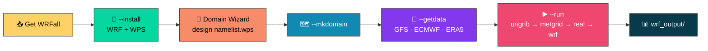

<div align="center">

# 🌪️ WRFall 🌦️

### No-root installer, domain builder, data fetcher & runner for **WRF / WPS**

*From a bare Linux account to a running forecast — ARW · Chem · Hydro · Fire*


### 🧭 [**Open the WRF / WPS Domain Wizard →**](https://goikelem.github.io/Automation-Utility-Scripts/WRF_WPS_Domain_Wizard.html)

[📘 User Guide](./WRFall_User_Guide.md) · [📄 Quick Reference (PDF)](./WRFall%20Quick%20Reference.pdf) · [🐪 Perl Guide (PDF)](./wrfall_install_pl_User_Guide.pdf) · [🧙 Domain Wizard](https://goikelem.github.io/Automation-Utility-Scripts/WRF_WPS_Domain_Wizard.html)

</div>

---

## 🌍 What is WRFall?

**WRFall** is a single script — `wrfall_install.py` (or its Perl twin `wrfall_install.pl`) — that handles
the whole life of a WRF setup **without root access** and using only the standard library:

| Stage | What WRFall does for you |
|:--|:--|
| 🔧 **Install** | Builds the support libraries (zlib, HDF5, NetCDF-C, NetCDF-Fortran, MPICH, libpng, JasPer, flex, byacc), then WRF and WPS |
| 🔄 **Update** | Builds a newer release next to the old one and reuses the libraries |
| 🗺️ **Domains** | Creates run directories with all links, folders and namelists in place |
| 📡 **Data** | Downloads **GFS**, **ECMWF IFS** or **ERA5** data for exactly the area of your domain |
| ▶️ **Run** | Runs `ungrib`, `metgrid`, `real` and `wrf`, then archives the products |

> 💡 The only optional extra dependency is the `cdsapi` module, needed for ERA5 downloads.

---

## 🔄 Workflow at a glance



---

## 📥 Get it

```bash
git clone https://github.com/goikelem/WRFall.git && cd WRFall && chmod +x wrfall_install.py
```

**Prefer Perl?** The only thing that changes is the extension (`.py` → `.pl`):

```bash
git clone https://github.com/goikelem/WRFall.git && cd WRFall && chmod +x wrfall_install.pl
```

### 🧰 Requirements

- 🐧 **64-bit Linux** with `gcc`, `g++`, `gfortran`, `make`, `tar`, `perl`
- Recommended: `tcsh`/`csh`, `m4`, `git`, `wget` or `curl`
- 🐍 Python **3.6+**
- 💾 About **36 GB** for one ARW build with base geography data (libraries ≈ 2 GB, each build ≈ 4 GB, WPS_GEOG ≈ 30 GB)

---

## 🔧 Install & update

```bash
./wrfall_install.py --install list            # list releases
./wrfall_install.py --install -arw            # newest release (or -chem -hydro -fire -fireideal -all)
./wrfall_install.py --install 4.6.0 -chem     # specific release
./wrfall_install.py --update                  # newer release, libraries reused
```

### 🎨 Build types

| Flag | Build | | Flag | Build |
|:-:|:--|:-:|:-:|:--|
| `-arw` | 🟢 WRF-ARW | | `-fire` | 🔴 WRF-Fire (real data) |
| `-chem` | 🟠 WRF-Chem | | `-fireideal` | 🟥 WRF-Fire (`em_fire`) |
| `-hydro` | 🔵 WRF-Hydro | | `-all` | 🟢🟡🔴 arw + chem + hydro + fire |

---

## 🗺️ Domain → data → run

### 🧭 Step 1 — Design your domain with the Domain Wizard

Use the browser-based **[WRF / WPS Domain Wizard](https://goikelem.github.io/Automation-Utility-Scripts/WRF_WPS_Domain_Wizard.html)**
to draw your domains on an interactive map and generate `namelist.wps` and `namelist.input`
(plus optional **WRF-Chem**, **WRF-Fire** and **WRF-Hydro / HRLDAS** namelists).

> 🖥️ Prefer a desktop tool? The repo also ships a Python version:
> [`WRF_WPS_Domain_Wizard_chem_hydro_fire.py`](./WRF_WPS_Domain_Wizard_chem_hydro_fire.py)

### 🗂️ Step 2 — Create the domain, download data and run

```bash
./wrfall_install.py --mkdomain mydom                       # add -fire / -chem when several builds exist
cd ~/Build_WRF/mydom                                       # edit namelist.wps first
./wrfall --getdata gfs --date 20261016 --cycle 00 --end 72 # or ecmwf | era5
RUN_GEOGRID=1 ./wrfall --run 20261016 00 72 gfs            # or: --run auto
```

### 📡 Supported data sources

| Source | Command | Resolution | Notes |
|:--|:--|:-:|:--|
| 🇺🇸 **GFS** | `--getdata gfs` | 0.25° | NOAA NOMADS, subset to your area |
| 🇪🇺 **ECMWF IFS** | `--getdata ecmwf` | 0.25° | Open data from `data.ecmwf.int` |
| 🛰️ **ERA5** | `--getdata era5` | 0.25° | Reanalysis via the CDS API (needs `cdsapi` and `~/.cdsapirc`) |

WRFall reads domain 1 from `namelist.wps`, adds a margin (`--margin`, default 1°), snaps it to the 0.25° grid
and downloads only that area. Existing files are skipped, so a rerun simply fills the gaps.

### ▶️ What `--run` does

`(geogrid) → ungrib → metgrid → real.exe → wrf.exe`: it backs up your namelists, sets the dates, links the GRIB files
with the right Vtable, runs everything with your MPI settings and collects `wrfout_*` into
`<domain>/wrf_output/<YYYYMMDDCC>/`.

---

## 🧩 Extras

```bash
./wrfall_install.py --addpack domwiz,scripts,cdsapi   # Domain Wizard, utility scripts, ERA5 module
./wrfall_install.py --addgeog chem                    # also: mandatory | fire | any UCAR dataset
```

## 🌱 Load the environment

```bash
source ~/Build_WRF/etc/modulefiles/WRFARW.sh          # one build type at a time; see ~/WRF-DoList.txt
```

---

## 🚩 Handy flags

| Flag | Does |
|:--|:--|
| `--homedir DIR` | Install location (default `~/Build_WRF` or `$WRF_HOME`) |
| `--allyes` · `--dryrun` | No prompts · preview only |
| `--continue` · `--force` · `--force-libs` | Resume · rebuild WRF/WPS · rebuild libraries too |
| `--nogeog` · `--scour` | Skip WPS_GEOG · delete old release after update |
| `--dl-jobs N` · `--curl` · `--wget` · `--proxy H:P` | Download tuning |
| `--margin DEG` · `--bbox W E S N` | Data area: domain extent + margin, or explicit |
| `WRF_NP=8` · `REAL_NP=2` | MPI ranks for `wrf.exe` / `real.exe` |

## 📁 Layout

```
~/Build_WRF/  local/ (libs)  packages/  logs/  etc/modulefiles/  WPS_GEOG/  Scripts/
              WRF-<ver>-<Type>/  WPS-<ver>-<Type>/
              mydom/  GFS_Input/YYYYMMDDCC/  wrf_output/{metgrid,ungrib,geogrid,Plots}/  wrfall -> script
```

---

## 🔥 🧪 💧 Special builds

| Build | Highlights |
|:--|:--|
| 🔥 **WRF-Fire** | Real-data (`-fire`) and ideal (`-fireideal`) builds; `--addgeog fire` prepares `landfire/` and `highres_elev/` folders; fire-ready namelists |
| 🧪 **WRF-Chem** | Builds flex/byacc for KPP, patches known build problems; `--addgeog chem` fetches the chemistry datasets |
| 💧 **WRF-Hydro** | Merges NCAR's `wrf_hydro_nwm_public` v5.3.0 into WRF and builds with `WRF_HYDRO=1` |

---

## 🛟 Quick fixes

- **Interrupted?** Rerun with `--continue`; downloads resume.
- **Build failed?** Check `~/Build_WRF/logs/`; the *first* error is the cause.
- **WRF-Chem ≥ 4.7 KPP errors?** Use `--install 4.6.0 -chem --force`.
- **`[FAIL]` on GFS/ECMWF files?** The cycle may not be published yet; retry later.
- **`--run` limit:** 1–72 forecast hours per call.

---

## 📚 Documentation

| 📄 File | 📝 Description |
|:--|:--|
| 📘 [`WRFall_User_Guide.md`](./WRFall_User_Guide.md) | Full step-by-step guide (install, domains, data, runs, Fire, Chem, Hydro, flag reference, FAQ) |
| 📄 [`WRFall Quick Reference.pdf`](./WRFall%20Quick%20Reference.pdf) | One-page quick reference |
| 🐍 [`wrfall_install.py`](./wrfall_install.py) | The Python installer & runner |
| 🐪 [`wrfall_install.pl`](./wrfall_install.pl) | The Perl installer & runner |
| 🐪 [`wrfall_install_pl_User_Guide.pdf`](./wrfall_install_pl_User_Guide.pdf) | User guide for the Perl version |
| 🧙 [`WRF_WPS_Domain_Wizard_chem_hydro_fire.py`](./WRF_WPS_Domain_Wizard_chem_hydro_fire.py) | Desktop Domain Wizard (Chem / Hydro / Fire aware) |
| 🧭 [**Web Domain Wizard**](https://goikelem.github.io/Automation-Utility-Scripts/WRF_WPS_Domain_Wizard.html) | Browser-based WRF / WPS Domain Wizard |

## 📖 References

- 🌀 **WRF Model:** <https://github.com/wrf-model/WRF>
- 🎓 **WRF Online Tutorial:** <https://www2.mmm.ucar.edu/wrf/OnLineTutorial/>
- 🇺🇸 **NOAA NOMADS:** <https://nomads.ncep.noaa.gov/>
- 🇪🇺 **Copernicus Climate Data Store (ERA5):** <https://cds.climate.copernicus.eu/>

---

<div align="center">

🐛 Found a bug or have an idea? [Open an issue](https://github.com/goikelem/WRFall/issues).

⭐ *If WRFall saves you time, give the repo a star!* ⭐

**Now go forth and simulate!** 🌍

</div>
